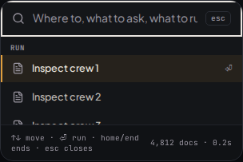
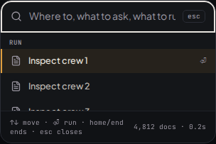
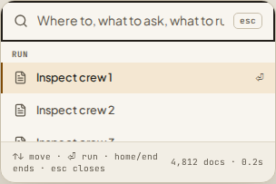
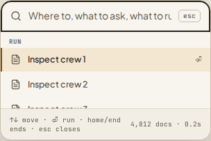
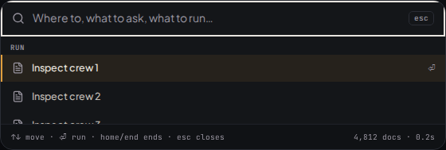
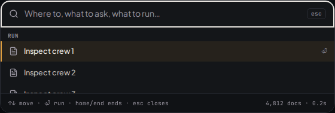
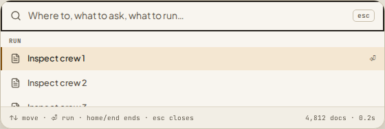
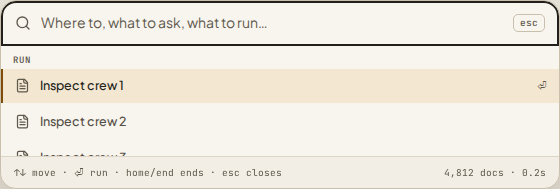

# Rounded-container focus review

These are focused real-Chromium captures from the pinned Playwright 1.63.0
image, in dark and paper themes at 320px and 1280px. The recording captures
use the fine-pointer scene. `before/` retains the original treatments from
`27a368b6ed7c8e80b33613da0c33af6776d74f75`; `after/` shows this correction.
These review images are evidence, not baseline inputs that can be updated to
make a pixel assertion pass. The executable checks live in
`focus-frames.visual.tsx` and the recording-tray disclosure tests.

| Query focus | Before | After |
| --- | --- | --- |
| Dark, 320px |  |  |
| Paper, 320px |  |  |
| Dark, 1280px |  |  |
| Paper, 1280px |  |  |

Each directory contains the same four theme/width cells for these states:

| Filename suffix | Inspected focus state |
| --- | --- |
| `query` | Command query, both upper arcs; native text-input focus |
| `filter-first` | First pill in the unpadded filter strip; End reaches the last |
| `slash-first`, `slash-last` | Both menu edges, including the status sibling |
| `tray-expanded`, `tray-collapsed` | Disclosure top arcs and all collapsed arcs |
| `tools-first-corners` | Actual Settings tool-permission row in a zero-pad Surface |
| `graph-last-corners` | Actual graph form row at the Surface's bottom boundary |
| `locked-model-edges` | Full-width locked-model action inside its scroll panel |
| `wrapped-enabled-edge`, `wrapped-disabled-edge` | Suggestion focus with and without an enabled callback |
| `tight-button-edge` | Full-width control inside a 3px-pad Surface |

Runtime review captures additionally cover command first/last results and End
scrolling, filter first/last focus, padded Surface, Composer and Other fields,
both edges of Settings/graph rows, and the padded scrolling suggestions. These
remain under `.vitest-attachments/focus-frames/` in hosted browser artifacts.

The source audit covers every kit/react use of the shared field, row and
control treatments. Other field sites (AskUserListCard and AskUserFormCard)
have padded clipping ancestors. Standalone FileRow, QueueItemRow,
SearchResultCard, ChoiceOption, ActionCard, AttachmentRow, LinkPreviewCard,
RelatedFiles, SessionStrip and PendingFollowUps rows have their own radii or
square clipping boundaries. Rail and tab rows sit inside square boundaries.
Button, Toggle, IconButton, TextButton, FeedbackRow, InlineToast, Disclosure,
Placeholder, StreamingAnswer, AgentOrbit and tracker controls have space for
outside indicators; tightly padded Surface descendants are the shared
exception corrected here.

The shared edge-stack treatment also repairs attachment popovers, session
actions, share menus, graph search/maintenance rows and graph node/unreachable
lists. Header-bearing graph scroll bodies inherit bottom corners only. Topics
and other nonclipped graph disclosures have no rounded clipping boundary;
settings tab/tool-timeline rows already carry their own radii. Native fields
and custom focus treatments remain governed by their existing tests.
